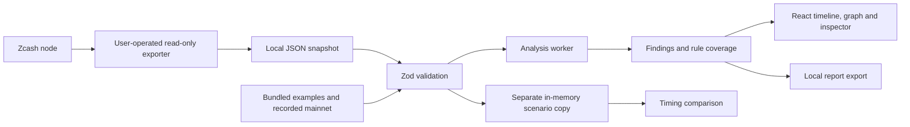

# Architecture

Ostrakon is a static React/TypeScript application deployed on Vercel. A dedicated
Web Worker analyzes bounded, validated datasets. An optional Python CLI exports
read-only node data into the same import format; it is separate from the website.

## Data flow

The browser requests static application assets only. Choosing the dated mainnet
recording does not contact a chain-data provider. Imports, findings and scenarios
stay in memory; refreshing clears them. There is no application backend, database,
account system, analytics, wallet connection or key handling.

## Components

| Component | Responsibility |
| --- | --- |
| `src/core/schema.ts` | Strict dataset/report validation, bounded inputs and consistent block metadata. |
| `src/core/analyze.ts` | Deterministic rules with exact integer accounting and every competing candidate retained. |
| `src/core/exclusions.ts` | Stable exclusion codes, first-blocking reasons and reading guidance. |
| `src/core/analysis.worker.ts` | Analysis isolated from rendering; cancellation and stale-result protection. |
| `src/core/datasets.ts` | Fresh copies of synthetic examples and the dated mainnet recording. |
| `src/components/FlowGraph.tsx` | Bounded display of public pool movements and dashed candidate relationships. |
| `src/components/TransactionExplorer.tsx` | Timeline/table, whole-dataset rule counts and combined record filters. |
| `src/App.tsx` | Ephemeral workspace state, inspection, simulation and local file transfer. |
| `scripts/export_node.py` | Bounded read-only RPC collection, previous-output resolution and exact normalization. |

## Accounting and evidence

Amounts are integer zatoshis, serialized as decimal strings. Positive Ostrakon
pool deltas mean value enters a shielded pool; node value-balance signs are
converted explicitly by the exporter. Fees are accounted for alongside resolved
transparent amounts and all supported net pool balances. Net pool balances never
stand in for individual hidden notes or internal shielded payments.

The amount/time rule compares balanced, supported, single-pool entries and exits.
Unresolved amounts, migrations, transparent change, batched payouts, unsupported
versions and low-confirmation snapshots are excluded. Exclusion applies to that
rule; the record remains visible and can contribute to address-reuse findings.
There is no aggregate anonymity score.

Each finding retains its rule version, parameters, transaction IDs, rationale,
competing explanations and limitations. Observed address appearances are distinct
from inferred amount/time relationships. A lack of candidates describes only the
loaded dataset and rule window.

## Bounds and presentation

Imports are limited to 2 MB, 200 transactions and 16 transparent inputs/outputs per
transaction. Contradictory hashes or timestamps at one block height are rejected,
as is a hash reused at different heights. Backwards clocks across blocks are valid.
The [format](public/DATA_FORMAT.md) defines the complete input contract.

The graph displays at most four entries and four exits; analysis and report export
retain all bounded records and candidate sets. The timeline groups by block height,
then transaction ID. Same-block ordering does not imply execution or payment order.
Filters preserve separate whole-dataset and visible-record counts.

Worker results are bound to their dataset, parameters and run. Retired or cancelled
workers cannot publish stale results; pending analysis cannot claim eligibility.
Re-imported reports discard saved findings and calculate them again. The timing
lab changes an independent dataset copy on the main thread.

## Privacy and trust boundaries

Production uses self-hosted assets and a restrictive CSP including
`connect-src 'none'`. There are no third-party embeds, remote fonts, automatic
uploads or report contents in URLs. Report export is an explicit user action.
The development server has its own local HMR connection; production preview uses
the deployment headers for verification.

The optional exporter reads only `getblockchaininfo`, `getblock`, `getblockhash`
and `getrawtransaction`. It resolves previous transparent outputs, checks block
linkage and rechecks range/tip hashes before writing a new owner-only file.
Credentials and endpoint URLs stay outside the dataset. A remote node can observe
requests and the operator's IP; using a local node avoids that disclosure.
See the [exporter guide](docs/NODE_EXPORT.md) for limits and failure behavior.

The [recorded mainnet collection](docs/LIVE_SNAPSHOT.md) verifies one bounded
integration and cross-source field agreement. Neither the exporter nor the browser
cryptographically verifies consensus or transaction inclusion. Direct browser
address lookup, live reorg monitoring, viewing keys and wallet actions are outside
the implemented scope. See [verification](docs/VERIFICATION.md) for checked behavior.
