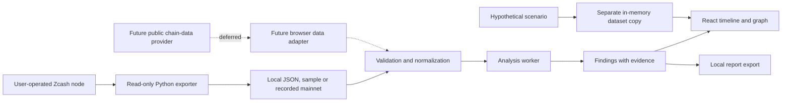

# Ostrakon — Privacy X-ray architecture

Status: Privacy X-ray selected by the user on 16 October 2026. The initial local
workbench and optional node exporter are implemented. A live public-node export
and its recorded browser path are verified for one bounded mainnet block; see
[the collection record](docs/LIVE_SNAPSHOT.md). Direct browser provider lookup is
deferred. See also [verification](docs/VERIFICATION.md).

## Product contract

Explain visible transaction facts and possible correlations, with evidence and
limitations. Never claim to reveal hidden shielded parties, prove ownership from
timing, or certify that a wallet is anonymous.

The initial release accepts documented local JSON, explicitly synthetic examples,
and a dated public mainnet recording. Public transparent address/transaction lookup
requires a separate browser-provider gate. Viewing keys and spending keys are excluded.

## Main journey

1. Choose a local import, synthetic example or dated mainnet recording. Operators can generate an import with
   the optional CLI node exporter. Public browser lookup is a future adapter.
2. See the data source, network, covered interval, and completeness.
3. Explore a transaction timeline and graph. Solid edges are observed flows;
   dashed edges are candidate relationships, never asserted wallet ownership.
4. Open a finding to inspect its transactions, rule, thresholds, competing
   candidates, limitations, and practical privacy guidance.
5. Adjust a hypothetical scenario to learn how a rule responds. Simulation stays
   separate from chain evidence and never receives a privacy-guarantee badge.
6. Export a report locally, with its provenance, coverage, and caveats.

## System boundaries

Implemented stack: Vite, React, TypeScript, Zod, and a Web Worker for imported-data
analysis. The bounded simulation uses a separate in-memory copy on the main thread.
Static Vercel configuration is included, but no remote deployment has occurred.
Rust/WASM is unnecessary for the initial public-data rules.
No application database, login, scheduled fund transfers, or signing service.

The optional `scripts/export_node.py` is a separate operator tool, not an
application server. It reads a bounded node block range, resolves previous
transparent outputs, converts node pool-balance signs, and checks block linkage
and hashes before writing a local file. Authentication stays in the operator's
environment. Endpoints and credentials are omitted from exported data. Remote
node operators can observe the queries; a local node avoids that disclosure.
See [Decision 001](docs/decisions/001-node-export.md) and the
[exporter guide](docs/NODE_EXPORT.md). A nine-request export from a public Zebra
gateway is recorded with cross-source checks and replay tests. That demonstrates
one bounded operation, not universal node compatibility or production reliability.

A static frontend still depends on an external chain-data provider. Free hosting
and free data access are targets, not guarantees. If browser access or indexing
requires a backend, record that architecture change before implementing it.

## Data and analysis

Use integer zatoshi values internally, serialized as decimal strings. Keep block
height, block hash, provider, observed time, network, and supported transaction
version with each record. Resolve transparent previous outputs before attributing
input amounts. Do not invent addresses or values for shielded outputs.
Reject contradictory hash/timestamp claims at one height and hashes reused at
different heights. A backwards clock between different blocks is allowed.

Each dataset declares a block interval, pagination completion, missing records,
and retrieval time. Each finding has a rule version, evidence transaction IDs,
parameters, rationale, competing explanations, and limitations. Unsupported
transactions and incomplete intervals produce an explicit unknown state.

Initial rules:

- Address reuse: a directly observable repeated transparent address in the loaded
  dataset, without assuming every address belongs to one person.
- Amount/time candidates: compare eligible pool-entry and pool-exit transactions
  within a defined dataset and window. Show every matching candidate. Exclude
  ambiguous multi-pool or mixed-flow cases until their accounting is supported.
- Coverage warnings: missing previous outputs, incomplete ranges, and unsupported
  transaction versions prevent stronger conclusions.

No aggregate anonymity percentage. Exact arithmetic, fee handling, change,
batched payments, migration transactions, and net pool balance changes must be
handled explicitly. A lack of matches means only that these rules found none in
this dataset.

## Privacy and failure behavior

Public lookups disclose the queried identifier and IP to the provider. Explain
that before lookup; local-file analysis avoids that query. Keep imported data and
findings in memory by default. No analytics, session replay, remote fonts, or
third-party embeds on analysis screens. Do not put addresses or reports in URLs.

Use a restrictive content security policy, render memos as text if later supported,
bound file sizes and graph expansion, and allow cancellation of worker tasks.
Network errors must not become reassuring privacy scores. Live reorg detection
is not implemented; every import is labeled an unverified snapshot. A future
provider must invalidate observations affected by stale data or reorgs.
Report export is explicit because it can expose
financial activity. No automatic public sharing.

## Initial implementation boundaries

`src/core/schema.ts` validates datasets/reports and enforces bounded input.
`src/core/analyze.ts` is a deterministic, side-effect-free rule engine.
`src/core/analysis.worker.ts` isolates normal analysis from rendering.
`src/core/datasets.ts` supplies independent copies of the bundled examples and
recorded mainnet dataset. Both load as static application assets; choosing a
recording does not query a chain provider. `src/data/mainnet-3520054.json` is public
chain data with a pinned collection record, not an imported private dataset.
`src/components/FlowGraph.tsx` displays at most four entries and four exits;
the analysis and report retain the complete bounded dataset and candidate sets.
`src/components/TransactionExplorer.tsx` presents every bounded record in a
block-height timeline or table. Within a block, IDs provide deterministic display
order, not an execution sequence. Eligibility and exclusion-reason filters combine
with local ID/address search. Whole-dataset rule counts remain separate from the
visible filtered count. Switching datasets resets notebook filters.
`src/core/exclusions.ts` defines stable codes, first-blocking reasons and reading
guidance. Exclusions apply only to the simple amount/time rule, so excluded
records may still contribute to address-reuse findings. Pending results never
produce eligibility claims, including in the transaction inspector.
`src/App.tsx` manages ephemeral state, inspection, scenarios and file transfer.

Production uses self-hosted assets and `connect-src 'none'`. The development
server needs its own local HMR connection; use production preview for CSP checks.
Reports are re-importable, but saved findings are discarded and recalculated.

## Future router gate

Before a router enters scope, demonstrate a supported shielded destination,
quote/deposit lifetimes, bounded failure/refund behavior, actual wallet support,
and a meaningful threat model for source observers and swap operators. Evaluate
privacy against independent heuristics with false-positive measurements. Passing
an API test alone does not pass the privacy gate.
