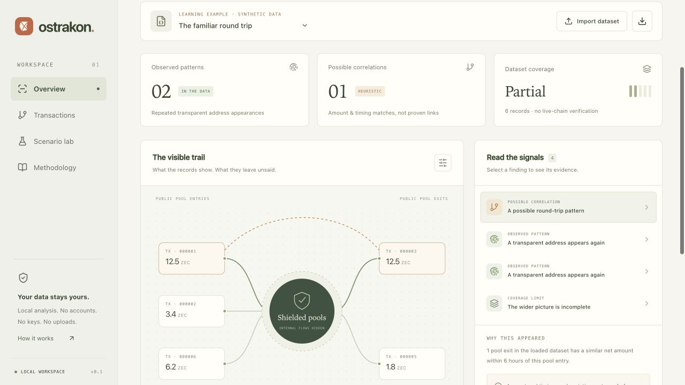

# Ostrakon

**Privacy, in plain sight.** A browser-local Zcash workbench that turns public
transaction patterns into inspectable evidence, possible correlations and clear
coverage limits.

[Open the app](https://ostrakon-kappa.vercel.app/) ·
[Watch the 1:47 demo](https://youtu.be/gIAtyuNJ6Ns) ·
[Verify the mainnet recording](docs/LIVE_SNAPSHOT.md)



*The screenshot shows a synthetic learning example. The app also includes a
separately labeled recording of real mainnet data.*

## Try the mainnet recording

1. Open the app and choose **Mainnet · 7 records · 16 Oct 2026**.
2. Open **Transactions**: all seven records from block **3,520,054** remain
   visible, with **1 eligible** and **6 excluded** from the amount/time rule.
3. Inspect the eligible Ironwood exit: **0.25015 ZEC** net outflow equals a
   **0.25 ZEC** public payout plus a **0.00015 ZEC** fee.
4. Open **Dataset coverage** to inspect the source, collection time and limits.

The [collection record](docs/LIVE_SNAPSHOT.md) links the original node responses,
normalized export, CipherScan comparison and SHA-256 checksums. See the
[demo guide](docs/DEMO.md) for the complete walkthrough.

## What it does

- Explore every loaded transaction in a block timeline or table, with eligibility,
  exclusion-reason and ID/address filters.
- Inspect repeated transparent address appearances and bounded amount/time
  candidates. Competing matches stay visible; correlations do not assert ownership.
- Read exact pool balances, fees, supporting records and rule explanations.
- Change timing in a separate simulation while preserving the original data.
- Import local JSON, export analysis reports, and re-import them for fresh analysis.
- Create bounded snapshots with the optional [read-only node exporter](docs/NODE_EXPORT.md).

Analysis uses integer zatoshis in a browser worker. There are no accounts, wallet
connections, viewing/spending keys, analytics or automatic persistence. Imports
remain in memory and disappear on refresh. The deployed frontend makes no
chain-data requests; production CSP uses `connect-src 'none'`.

## Scope and limits

Ostrakon analyzes snapshots. The bundled mainnet dataset is a dated recording,
not a live address scan or a wallet's history. Imported records are unverified;
the browser does not verify consensus, chain inclusion, current confirmations
or reorg status. Agreement between public services is not consensus verification.

Amount/time rules compare eligible net pool movements, not hidden note values.
Exclusion is not a privacy verdict, and zero matches do not establish anonymity.
Synthetic examples are explicitly labeled. Input is bounded to **2 MB** and
**200 transactions**; see the [data format](public/DATA_FORMAT.md).

## Run locally

Use Node.js **22.22.2+** on the 22.x line, or another version supported by
`package.json`, and npm. The optional exporter and full check suite require
Python **3.10+**, using only its standard library.

```sh
npm ci
npm run dev
```

The development server runs at `http://127.0.0.1:5173`. Override the port with
`npm run dev -- --port 5178` if needed.

```sh
npm run check       # TypeScript, analysis, UI and exporter tests
npm run build       # Static production output in dist/
npm run preview     # Production preview with Vercel security headers
```

Vercel configuration is included. The website requires no environment variables;
optional node RPC settings are documented in the exporter guide.

## Documentation

- [Architecture](ARCHITECTURE.md)
- [Mainnet evidence](docs/LIVE_SNAPSHOT.md)
- [Demo walkthrough](docs/DEMO.md)
- [Node exporter](docs/NODE_EXPORT.md)
- [Verification and test coverage](docs/VERIFICATION.md)
- [Contributing](CONTRIBUTING.md)

## License

[MIT](LICENSE), copyright 2026 techbone. Third-party dependencies and archived
fixtures retain their own licenses and notices.
