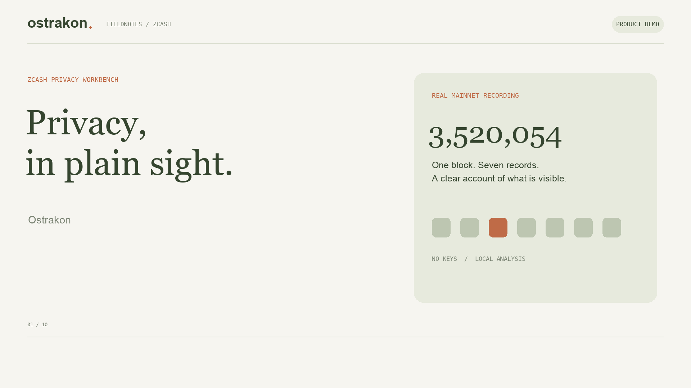

# Ostrakon judge demo



[Watch the uploaded demo on YouTube](https://youtu.be/gIAtyuNJ6Ns).

The video leads with the recorded mainnet integration, then uses an explicitly
synthetic example to explain the correlation heuristic. These are actual captures
of the deployed application, edited with explanatory titles, captions and motion;
they are not a continuous screen recording. Narration uses a local synthetic voice.
No app UI or analysis result is fabricated for the video.

The checked cut is **1:47.50**, **1920 × 1080**, **24 fps**, with H.264 video,
stereo AAC audio and burned captions. Samantha's shorter narration has deliberate
phrase pauses and reading holds. An original 80 BPM instrumental score plays
underneath, with automatic volume reduction during speech and gentle fades.
Ten representative frames were decoded for
review; the encoded audio mix decoded successfully and every source narration
clip contained non-silent samples. [Production metadata](production.json) records
the final MP4 checksum. The video has been uploaded to YouTube; the public oEmbed
endpoint returns the expected title. Event submission has not been confirmed.

## Judge verification path

1. Open [Ostrakon](https://ostrakon-kappa.vercel.app/) and select **Mainnet · 7
   records · 16 Oct 2026**.
2. Open **Dataset coverage**. Check mainnet, block **3,520,054**, collection time,
   source label and the link to the collection record.
3. Open **Transactions**. Expect **1 eligible · 6 excluded · 7 loaded**.
4. Inspect transaction
   `206dd86e7df343e15ccd460a1f8577e6393c359499b4d388b90848ba5155bbd6`.
   Its **0.25015 ZEC** net Ironwood outflow equals a **0.25 ZEC** public payout
   plus a **0.00015 ZEC** fee.
5. Filter **No public payout**. Two records expose a public fee contribution;
   hidden recipients and payment amounts are not inferred.
6. Return to **Overview**. Zero candidates in this one-block snapshot are not a
   privacy guarantee. Switch to **The familiar round trip** only to demonstrate
   the explicitly synthetic amount/time example and hypothetical scenario lab.

The [collection record](../LIVE_SNAPSHOT.md) links the decoded node responses,
original normalized export, CipherScan comparison and SHA-256 checksums. The
integration demonstrates handling of real recorded mainnet data. It does not
cryptographically prove chain inclusion, consensus validity, current confirmations,
reorg status, ownership or anonymity. Tatum and CipherScan may share infrastructure.

## Editable production files

- [Scene script](scenes.json): narration, on-screen claims and capture references.
- [Renderer](render.py) and [native encoder](render.swift): 1920 × 1080 H.264/AAC
  MP4, burned captions and SRT sidecar.
- [Original score and mixer](music.py): synthesized keys, pads, bass and quiet
  percussion, with no third-party recordings or sampled songs. The deterministic
  composition is titled **Fieldnotes No. 1** and its source is MIT licensed.
- `captures/`: original 1280 × 720 captures from the deployed application.
- [Title card](poster.png): a small preview retained for GitHub readers.
- Generated video, audio and review contact sheets: `exports/demo/` at the
  repository root. This directory is ignored; do not commit the rendered MP4.

Rendering requires macOS, Python 3.10+ with Pillow and NumPy, and the Swift command-line
tools. Video and audio encoding use the built-in AVFoundation framework. These are
optional video-production tools, not application dependencies. The default
narration uses macOS `say` with the selected Samantha voice at rate 175;
`--voice` and `--rate` allow a different installed voice and speaking rate. To use
your own voice, provide one uncompressed PCM WAV file per scene ID under `exports/demo/audio/`,
remove the corresponding `.timing.json` sidecars, and run with `--reuse-audio`.
The `--no-music` option produces narration alone.

```sh
python3 docs/demo/render.py
```

To check the encoded file and extract representative frames:

```sh
swift -module-cache-path exports/demo/swift-cache docs/demo/verify.swift \
  exports/demo/ostrakon-demo.mp4 exports/demo/encoded-review exports/demo/render-plan.json
```

The renderer measures each spoken phrase, inserts 0.65-second internal pauses
(0.85 seconds before the closing tagline), adds reading holds, derives subtitle timing,
and refuses to render a cut longer than 120 seconds. It validates audio is nonempty.
The mix keeps music about 19 dB below active narration, with at least 1 dB of peak
headroom in the checked cut. `mix-stats.json` records levels and pause coverage;
`original-music.wav`, `narration-with-pauses.wav` and `mixdown.wav` retain the stems
and final stereo audio under `exports/demo/`.
Review the final MP4 before uploading; publishing and hackathon submission are
separate actions. Use the title **Ostrakon — Zcash Privacy, in Plain Sight**.

Suggested video description:

> Ostrakon is a browser-local Zcash privacy workbench. This demo inspects a real
> recorded mainnet block, including Ironwood payout and fee accounting, then uses
> a clearly labeled synthetic example to explain amount/time correlations. Mainnet
> block 3,520,054 was collected on 16 October 2026 and public fields were compared
> with CipherScan. It is a dated snapshot, not a live address scan or privacy proof.
> Try it: https://ostrakon-kappa.vercel.app/ · Source and reproducible evidence:
> https://github.com/techbone/Ostrakon
